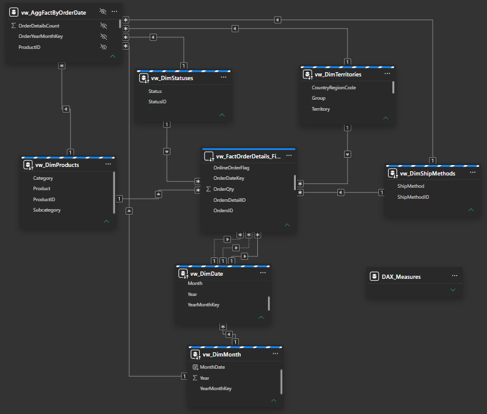
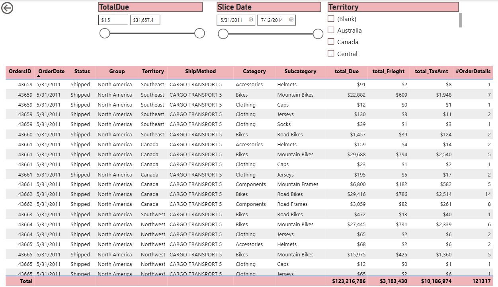

# Project Title

A brief description of what this project does and who it's for

# AdventureWorks Sales Analytics: Power BI Data Modeling Deep Dive

An end-to-end Power BI project built on the **AdventureWorks2022** SQL Server database. The focus is **semantic-model design and performance**: a star schema built with SQL views, mixed storage modes (Import, DirectQuery, Dual), and a user-defined aggregation table, with a report layer that covers time-series analysis, forecasting, group and territory performance, and custom tooltips.


## Project goals

- Build a clean **star schema** on top of AdventureWorks2022 using SQL views.
- Use **Import, DirectQuery and Dual** storage modes together to balance speed and data freshness.
- Design an **aggregation table** over the fact table and choose the best grain.
- Perform **time-series analysis** and **forecasting**.
- Build **custom tooltips** and interactive report pages.

## Architecture

```
AdventureWorks2022 (SQL Server)
        |
        |  SQL views (star schema)            -> /sql
        v
Power BI Desktop
        |  Power Query (M): cleaning and transformation
        |  Semantic model: relationships, storage modes, aggregations
        |  DAX measures                       -> /docs/README.md
        v
Report pages and custom tooltips              -> /powerbi
```

## Data model at a glance

| Layer       | Objects                                                                                                          |
| ----------- | ---------------------------------------------------------------------------------------------------------------- |
| Fact        | `vw_FactOrderDetails_Final` (order-line grain, DirectQuery)                                                      |
| Aggregation | `vw_AggFactByOrderDate` (Import, month x product x territory x ship method x status)                             |
| Dimensions  | `vw_DimProducts`, `vw_DimTerritories`, `vw_DimShipMethods`, `vw_DimStatuses`, `vw_DimDate`, `vw_DimMonth` (Dual) |
| Measures    | `DAX_Measures` table                                                                                             |

The fact table carries three dates (order, due, ship) and uses a single date dimension with one active and two inactive relationships.



Full details are in **[docs/README.md](docs/README.md)**: tables, columns, relationships, storage modes, aggregation grain, and measures.

## Key techniques

- **Star schema with SQL views**: all shaping happens in the database, so the model stays thin and the logic is versioned in this repo.
- **Mixed storage modes**: the large detail fact stays in DirectQuery, the aggregation is imported, and dimensions are Dual so they serve both.
- **Aggregations**: most visuals are answered from the small imported table, and only detail-level queries reach the source.
- **Role-playing dates**: order date is the active relationship; due and ship date are activated with `USERELATIONSHIP`.
- **Time-series analysis**: monthly trends, reference lines, and an animated play-axis page.
- **Forecasting**: forecast with confidence bands for sales and order volume, filterable by group and territory.
- **Custom tooltips**: report-page tooltips that add distribution and product context on hover.

## Report preview

|                                                                            |                                                                  |
| -------------------------------------------------------------------------- | ---------------------------------------------------------------- |
|                                       |        |
|                          |  |
|  |                       |

Every page is described in **[powerbi/README.md](powerbi/README.md)**.

## Repository structure

```
├── README.md
├── .gitignore
├── sql/                    SQL views that define the star schema
├── powerbi/
│   ├── README.md           Report pages, tooltips, and visuals
│   └── screenshots/        Report screenshots
└── docs/
    ├── README.md       Detailed data model documentation
    └── data-model.png      Data model diagram
```

## Getting started

1. Install SQL Server and restore the **AdventureWorks2022** database.
2. Run the scripts in [`/sql`](sql) to create the `vw_*` views.
3. Open Power BI Desktop and connect to your SQL Server instance and database.
4. Load the views and apply the relationships, storage modes, and aggregation settings described in [docs/README.md](docs/README.md).

## Tech stack

- SQL Server, AdventureWorks2022
- T-SQL views
- Power BI Desktop, Power Query (M), DAX

## Author

**[Ahmed Omar]**

- LinkedIn: [[LinkedIn profile](https://www.linkedin.com/in/ahmed-mohamed-omer-439ab6277/)]
