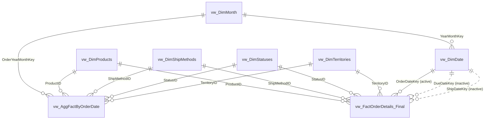

# Data Model

This document describes the Power BI semantic model built on top of **AdventureWorks2022**: a star schema exposed through SQL views, optimized with mixed storage modes (Import / DirectQuery / Dual) and a user-defined aggregation table.


## Contents

1. [Overview](#overview)
2. [Model diagram](#model-diagram)
3. [Tables](#tables)
4. [Relationships](#relationships)
5. [Storage modes](#storage-modes)
6. [Aggregation design](#aggregation-design)
7. [Measures](#measures)
8. [Design decisions](#design-decisions)

---

## Overview

| Item | Value |
|---|---|
| Source | AdventureWorks2022 (SQL Server) |
| Shaping layer | SQL views (see [`/sql`](../sql)) |
| Schema | Star schema (one fact table, four dimensions, date + month dimensions) |
| Fact grain | One row per **sales order line** (`OrdersDetailID`) |
| Aggregation grain | **Month x Product x Territory x Ship method x Status** |
| Tables | 11 (1 fact, 6 dimensions, 3 aggregation tables, 1 measures table) |
| Relationships | 13 (10 active, 3 inactive) |
| Measures | 6 |

---

## Model diagram



> Solid lines are active relationships; dotted lines are inactive (activated in DAX with `USERELATIONSHIP`).
> `vw_AggFactByDueDate` and `vw_AggFactByShipDate` are hidden and have no relationships (see [Aggregation design](#aggregation-design)).

---

## Tables

### Fact table

#### `vw_FactOrderDetails_Final`

Order line items joined with order header attributes. Grain: one row per order line.

| Column | Type | Description |
|---|---|---|
| `OrdersID` | Whole number | Order (header) identifier |
| `OrdersDetailID` | Whole number | Order line identifier |
| `ProductID` | Whole number | FK to `vw_DimProducts` |
| `OrderQty` | Whole number | Quantity ordered |
| `UnitPrice` | Decimal | Unit price |
| `LineTotal` | Decimal | Line amount |
| `OrderDateKey` | Whole number | FK to `vw_DimDate[DateKey]` (active) |
| `DueDateKey` | Whole number | FK to `vw_DimDate[DateKey]` (inactive) |
| `ShipDateKey` | Whole number | FK to `vw_DimDate[DateKey]` (inactive) |
| `StatusID` | Whole number | FK to `vw_DimStatuses` |
| `OnlineOrderFlag` | True/False | Whether the order was placed online |
| `CustomerID` | Whole number | Customer identifier (degenerate, no dimension) |
| `SalesPersonID` | Whole number | Sales person identifier (degenerate, no dimension) |
| `TerritoryID` | Whole number | FK to `vw_DimTerritories` |
| `ShipMethodID` | Whole number | FK to `vw_DimShipMethods` |
| `TaxAmt` | Decimal | Tax amount |
| `Freight` | Decimal | Freight amount |
| `TotalDue` | Decimal | Total due |
| `UnitPrice (bins)` | Calculated column | `UnitPrice` bucketed in steps of 20, used for price-band analysis |

```dax
UnitPrice (bins) =
IF (
    ISBLANK ( 'vw_FactOrderDetails_Final'[UnitPrice] ),
    BLANK (),
    INT ( 'vw_FactOrderDetails_Final'[UnitPrice] / 20 ) * 20
)
```

### Dimension tables

#### `vw_DimProducts`

| Column | Type | Description |
|---|---|---|
| `ProductID` | Whole number | Primary key |
| `Product` | Text | Product name |
| `Subcategory` | Text | Product subcategory |
| `Category` | Text | Product category |

#### `vw_DimTerritories`

| Column | Type | Description |
|---|---|---|
| `TerritoryID` | Whole number | Primary key |
| `Territory` | Text | Territory name |
| `CountryRegionCode` | Text | Country/region code |
| `Group` | Text | Sales group (e.g. continent-level grouping) |

#### `vw_DimShipMethods`

| Column | Type | Description |
|---|---|---|
| `ShipMethodID` | Whole number | Primary key |
| `ShipMethod` | Text | Shipping method name |

#### `vw_DimStatuses`

| Column | Type | Description |
|---|---|---|
| `StatusID` | Whole number | Primary key |
| `Status` | Text | Order status label |

#### `vw_DimDate`

Marked as the model's **date table** (`Date` column, data category *Time*).

| Column | Type | Description |
|---|---|---|
| `Date` | Date | Primary key / date table column |
| `DateKey` | Whole number | Integer key (`yyyymmdd`), joined from the fact table |
| `Year` | Whole number | Calendar year |
| `Month` | Whole number | Month number |
| `Day` | Whole number | Day of month |
| `YearMonthKey` | Whole number | FK to `vw_DimMonth` |

#### `vw_DimMonth`

Month-grain dimension. It lets the aggregation table (stored at month grain) relate to the same calendar hierarchy as the date table.

| Column | Type | Description |
|---|---|---|
| `YearMonthKey` | Whole number | Primary key |
| `Year` | Whole number | Calendar year |
| `Month` | Whole number | Month number |
| `MonthDate` | Calculated column | First day of the month, formatted `mmmm yyyy` |

```dax
MonthDate = DATE ( vw_DimMonth[Year], vw_DimMonth[Month], 1 )
```

### Aggregation tables (hidden)

| Table | Date key | Relationships | Status |
|---|---|---|---|
| `vw_AggFactByOrderDate` | `OrderYearMonthKey` | Yes (5) | Active aggregation table |
| `vw_AggFactByDueDate` | `DueYearMonthKey` | None | Hidden, not related |
| `vw_AggFactByShipDate` | `ShipYearMonthKey` | None | Hidden, not related |

All three share the same measure columns: `TotalDue`, `TotalFreight`, `TotalTax`, `OrderDetailsCount` (and `TotalQty` on the order-date table). Details are in [Aggregation design](#aggregation-design).

### Measures table

#### `DAX_Measures`

A dedicated table that holds only measures. See [Measures](#measures).

---

## Relationships

All relationships are **many-to-one**, **single** cross-filter direction, and have **Assume referential integrity** enabled (required for DirectQuery to use inner joins and for aggregations to be hit reliably).

| # | From (many) | To (one) | Active | Notes |
|---|---|---|---|---|
| 1 | `vw_FactOrderDetails_Final[ProductID]` | `vw_DimProducts[ProductID]` | Yes | |
| 2 | `vw_FactOrderDetails_Final[TerritoryID]` | `vw_DimTerritories[TerritoryID]` | Yes | |
| 3 | `vw_FactOrderDetails_Final[ShipMethodID]` | `vw_DimShipMethods[ShipMethodID]` | Yes | |
| 4 | `vw_FactOrderDetails_Final[StatusID]` | `vw_DimStatuses[StatusID]` | Yes | |
| 5 | `vw_FactOrderDetails_Final[OrderDateKey]` | `vw_DimDate[DateKey]` | **Yes** | Primary date relationship |
| 6 | `vw_FactOrderDetails_Final[DueDateKey]` | `vw_DimDate[DateKey]` | No | Role-playing date, use `USERELATIONSHIP` |
| 7 | `vw_FactOrderDetails_Final[ShipDateKey]` | `vw_DimDate[DateKey]` | No | Role-playing date, use `USERELATIONSHIP` |
| 8 | `vw_DimDate[YearMonthKey]` | `vw_DimMonth[YearMonthKey]` | Yes | Links day grain to month grain |
| 9 | `vw_AggFactByOrderDate[OrderYearMonthKey]` | `vw_DimMonth[YearMonthKey]` | Yes | Aggregation to month |
| 10 | `vw_AggFactByOrderDate[ProductID]` | `vw_DimProducts[ProductID]` | Yes | Aggregation to product |
| 11 | `vw_AggFactByOrderDate[TerritoryID]` | `vw_DimTerritories[TerritoryID]` | Yes | Aggregation to territory |
| 12 | `vw_AggFactByOrderDate[ShipMethodID]` | `vw_DimShipMethods[ShipMethodID]` | Yes | Aggregation to ship method |
| 13 | `vw_AggFactByOrderDate[StatusID]` | `vw_DimStatuses[StatusID]` | Yes | Aggregation to status |

### Role-playing date dimension

The fact table carries three dates (order, due, ship) but there is a single `vw_DimDate`. Only the **order date** relationship is active. To analyze by another date, activate the relationship inside a measure:

```dax
Total Due by Ship Date =
CALCULATE (
    [total_Due],
    USERELATIONSHIP ( vw_FactOrderDetails_Final[ShipDateKey], vw_DimDate[DateKey] )
)
```

---

## Storage modes

| Table | Storage mode | Why |
|---|---|---|
| `vw_FactOrderDetails_Final` | DirectQuery | Largest table, kept at the source and queried only for detail-level requests |
| `vw_AggFactByOrderDate` | Import | Small pre-aggregated table, answers most visuals from memory |
| `vw_DimProducts`, `vw_DimTerritories`, `vw_DimShipMethods`, `vw_DimStatuses`, `vw_DimDate`, `vw_DimMonth` | Dual | Can be served from cache when paired with the Import aggregation and pushed down as joins when paired with the DirectQuery fact |
| `DAX_Measures` | Import | Measures only |

---

## Aggregation design

The detail fact table stays in DirectQuery. `vw_AggFactByOrderDate` is an Import table that pre-aggregates it, and Power BI automatically routes a query to the aggregation when every column it needs is available there. Otherwise the query falls through to the DirectQuery fact.

**Grain:** `OrderYearMonthKey` x `ProductID` x `TerritoryID` x `ShipMethodID` x `StatusID`

| Aggregation column | Summarization | Detail table / column |
|---|---|---|
| `OrderYearMonthKey` | Group by | Related through `vw_DimMonth` |
| `ProductID` | Group by | `vw_FactOrderDetails_Final[ProductID]` |
| `TerritoryID` | Group by | `vw_FactOrderDetails_Final[TerritoryID]` |
| `ShipMethodID` | Group by | `vw_FactOrderDetails_Final[ShipMethodID]` |
| `StatusID` | Group by | `vw_FactOrderDetails_Final[StatusID]` |
| `TotalDue` | Sum | `vw_FactOrderDetails_Final[TotalDue]` |
| `TotalFreight` | Sum | `vw_FactOrderDetails_Final[Freight]` |
| `TotalTax` | Sum | `vw_FactOrderDetails_Final[TaxAmt]` |
| `TotalQty` | Sum | `vw_FactOrderDetails_Final[OrderQty]` |
| `OrderDetailsCount` | Count | `vw_FactOrderDetails_Final` rows |

**Why this grain**

- **Month** instead of day: the main reporting and time-series visuals are month and year level, so a day-level aggregation would barely shrink the data.
- **Product, Territory, Ship method, Status** are kept so the aggregation still answers the common slicers and breakdowns. Anything that needs more detail (for example `CustomerID`, `SalesPersonID`, `OrdersID`, or a single day) falls back to DirectQuery.
- The aggregation reaches the date dimension through `vw_DimMonth`, which is why `vw_DimDate` is related to `vw_DimMonth`.

**Due-date and ship-date aggregation tables**

`vw_AggFactByDueDate` and `vw_AggFactByShipDate` follow the same pattern for the other two date roles, but are currently hidden and have no relationships or aggregation mappings. They are not used by any query path in the current model.

---

## Measures

All measures live in the `DAX_Measures` table, organized in display folders.

| Measure | Folder | Format | Expression |
|---|---|---|---|
| `total_Due` | Amount | Currency | `SUM ( vw_FactOrderDetails_Final[TotalDue] )` |
| `total_Frieght` | Amount | Currency | `SUM ( vw_FactOrderDetails_Final[Freight] )` |
| `total_TaxAmt` | Amount | Currency | `SUM ( vw_FactOrderDetails_Final[TaxAmt] )` |
| `#Customers` | Count | Whole number | `DISTINCTCOUNT ( vw_FactOrderDetails_Final[CustomerID] )` |
| `#OrderDetails` | Count | Whole number | `COUNT ( vw_FactOrderDetails_Final[OrdersDetailID] )` |
| `#Order` | Count | Whole number | `DISTINCTCOUNT ( vw_FactOrderDetails_Final[OrdersID] )` |

---

## Design decisions

- **Star schema through SQL views**: all shaping lives in `vw_*` views so the model stays thin and the logic is versioned in `/sql`.
- **Mixed storage modes**: Import for the aggregation, DirectQuery for the detail fact, Dual for dimensions so they can serve both sides without forcing limited (weak) relationships.
- **Single-direction filters**: dimensions filter facts only, which keeps filter propagation predictable and avoids ambiguity.
- **Integer surrogate keys for dates** (`DateKey`, `YearMonthKey`): smaller and faster to join than date columns.
- **Role-playing dates through inactive relationships**: one date table, three roles, no duplicated dimension.
- **Hidden aggregation tables and key columns**: report authors only see the detail model; Power BI substitutes the aggregation automatically.
