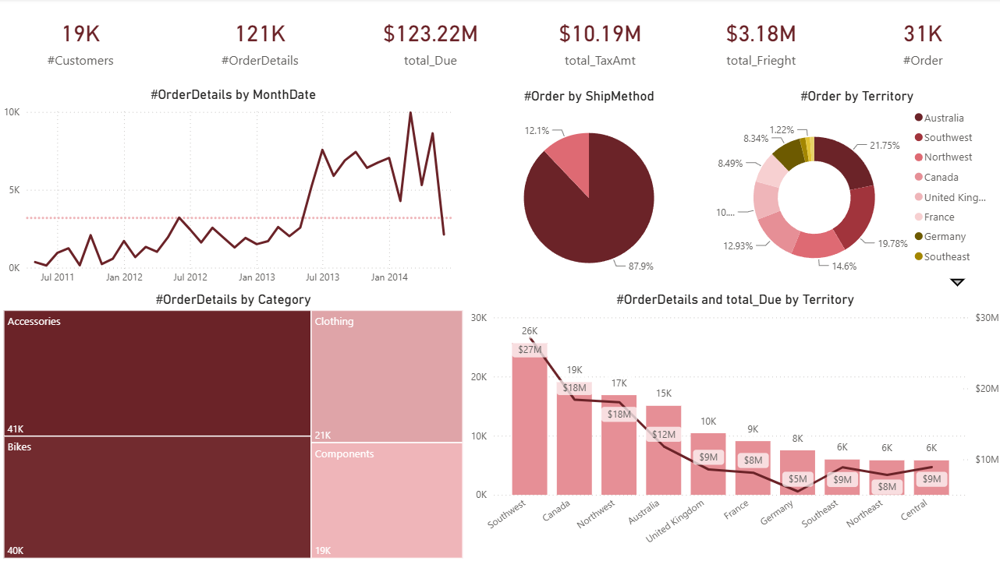
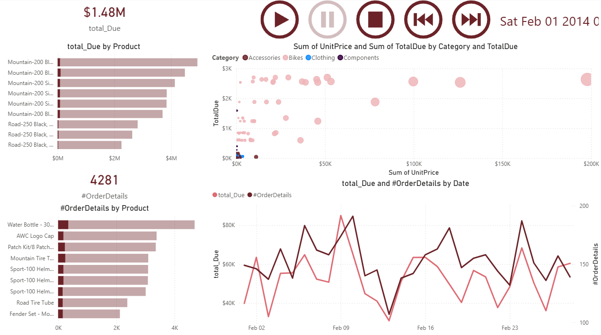
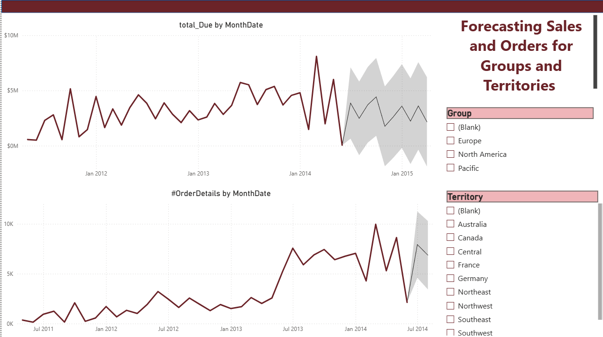
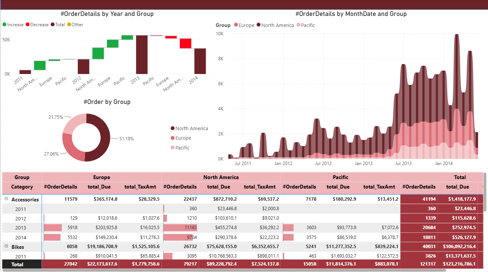
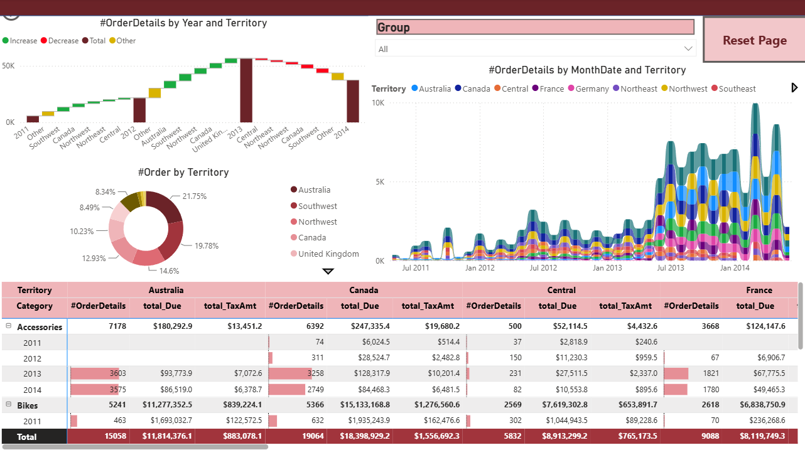
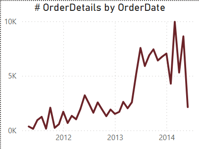
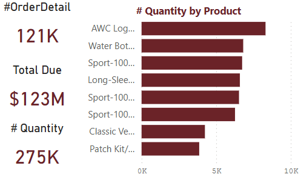

# Power BI Report

This folder documents the report layer of the project: pages, visuals, and custom tooltips. The model behind it (star schema, storage modes, aggregations, measures) is described in [../docs/README.md](../docs/README.md).

## Report pages

| #   | Page                                                | Purpose                                                   |
| --- | --------------------------------------------------- | --------------------------------------------------------- |
| 1   | [Home](#1-home)                                     | KPI overview of orders, sales, tax, and freight           |
| 2   | [TimeSeriesAnalysis](#2-timeseriesanalysis)         | Animated, day-level exploration of products and sales     |
| 3   | [Forecasting](#3-forecasting)                       | Forecast of sales and order volume by group and territory |
| 4   | [GroupsPerformance](#4-groupsperformance)           | Performance comparison across sales groups                |
| 5   | [TerritoriesPerformance](#5-territoriesperformance) | The same analysis at territory level                      |
| 6   | [Details](#6-details)                               | Order-level detail with filters                           |

Two **custom tooltip pages** support the visuals (see [Custom tooltips](#custom-tooltips)).

---

### 1. Home

The landing page gives a high-level view of the business.

- **KPI cards:** `#Customers`, `#OrderDetails`, `total_Due`, `total_TaxAmt`, `total_Frieght`, `#Order`.
- **#OrderDetails by MonthDate:** line chart of monthly order volume with an average reference line.
- **#Order by ShipMethod:** pie chart of order share per shipping method.
- **#Order by Territory:** donut chart of order share per territory.
- **#OrderDetails by Category:** treemap of order lines by product category.
- **#OrderDetails and total_Due by Territory:** combo chart comparing volume (columns) and sales due (line) for each territory.

### 2. TimeSeriesAnalysis

An animated page that replays activity day by day.

- **Play axis controls:** play, pause, stop, previous, and next buttons drive the date, which is shown at the top right.
- **KPI cards:** `total_Due` and `#OrderDetails` for the selected date.
- **total_Due by Product** and **#OrderDetails by Product:** bar charts of top products, with the current selection highlighted against the overall total.
- **Scatter chart:** unit price against total due, colored by category.
- **total_Due and #OrderDetails by Date:** dual-axis line chart of the daily trend.

### 3. Forecasting

Forecasts sales and order volume with confidence bands.

- **total_Due by MonthDate** and **#OrderDetails by MonthDate:** monthly history with forecasted values and a shaded confidence interval.
- **Slicers:** `Group` and `Territory` re-run the forecast for the selected slice.

### 4. GroupsPerformance

Compares the sales groups (Europe, North America, Pacific).

- **#OrderDetails by Year and Group:** waterfall chart showing how each group adds to the yearly total.
- **#Order by Group:** donut chart of order share per group.
- **#OrderDetails by MonthDate and Group:** layered monthly trend per group.
- **Matrix:** group by category and year with `#OrderDetails`, `total_Due`, and `total_TaxAmt`, including data bars.

### 5. TerritoriesPerformance

Same layout and visuals as **GroupsPerformance**, but at the **territory** level, so individual territories can be compared in the same way.

### 6. Details

Order-level detail view. Users can narrow the orders using filters on:

- **Due value**
- **Date**
- **Territories**

Because this page works at line level, queries here fall through the aggregation to the DirectQuery fact table.

---

## Custom tooltips

| Tooltip       | What it shows                                                                                                   |
| ------------- | --------------------------------------------------------------------------------------------------------------- |
| **Tooltip 1** | The distribution of `#OrderDetails` over date                                                                   |
| **Tooltip 2** | A quick overview of order volume, total sales due, total quantity, and the products with the highest quantities |

Both are report pages set as tooltip pages and assigned to visuals, so hovering a data point shows extra context without leaving the page.

---

## Performance notes

- Visuals on **Home**, **Forecasting**, and the **Groups/Territories** pages are at month, product, territory, ship method, and status grain, so they can be answered by the imported aggregation table.
- Day-level pages such as **TimeSeriesAnalysis** and **Details** need more detail than the aggregation holds and are served by the DirectQuery fact.
- Use **Performance Analyzer** in Power BI Desktop to see which visuals hit the aggregation and which go to the source.

## Measures used

| Measure         | Definition                     |
| --------------- | ------------------------------ |
| `total_Due`     | Sum of `TotalDue`              |
| `total_Frieght` | Sum of `Freight`               |
| `total_TaxAmt`  | Sum of `TaxAmt`                |
| `#Customers`    | Distinct count of `CustomerID` |
| `#OrderDetails` | Count of `OrdersDetailID`      |
| `#Order`        | Distinct count of `OrdersID`   |

## Screenshots

All screenshots are stored in [`screenshots/`](screenshots).
